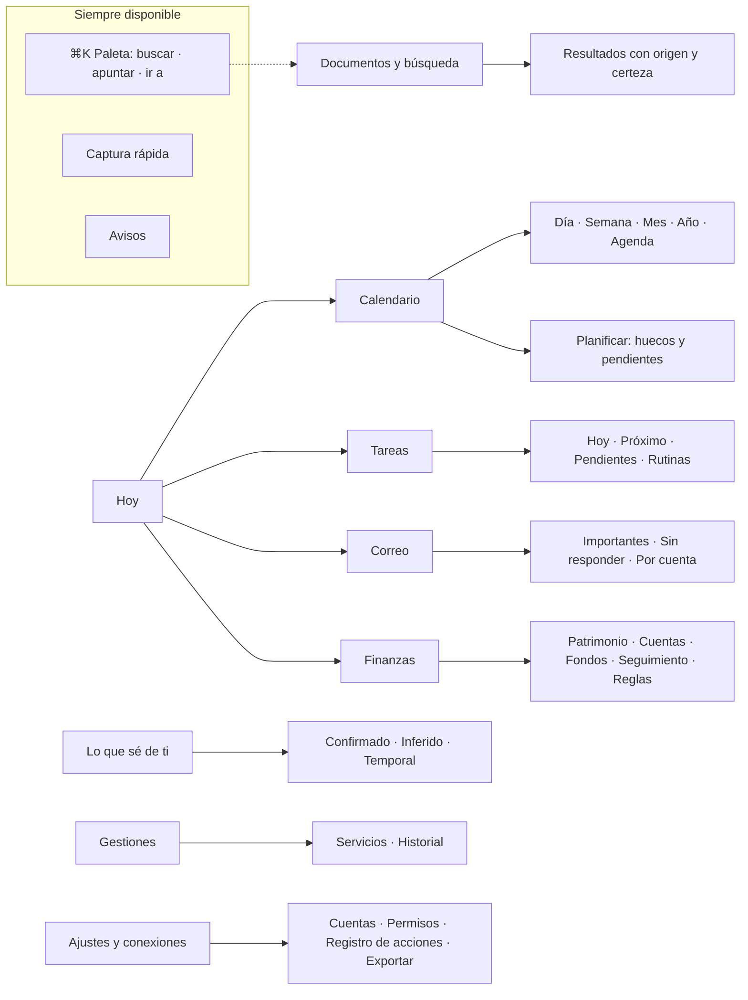
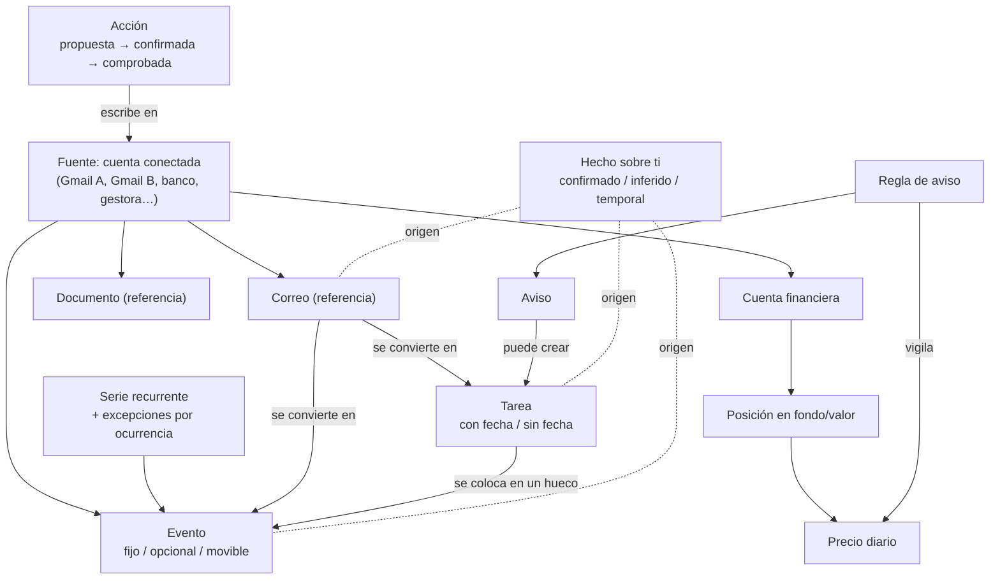

# 3. Arquitectura de información

Cómo se organiza la app: qué sectores hay, cómo se navega entre ellos y qué «objetos» comparten. Los diagramas usan Mermaid; GitHub los muestra dibujados.

## 3.1 Mapa de la app

**Navegación propuesta**
- **Mac y escritorio**: barra lateral con los sectores, contenido central e inspector a la derecha para el detalle del elemento seleccionado. Paleta ⌘K y atajo global de captura.
- **Android**: barra inferior con cinco destinos (**Hoy, Calendario, ＋ Apuntar, Finanzas, Más**). «Más» agrupa Tareas, Correo, Documentos, Lo que sé de ti, Gestiones y Ajustes. La búsqueda va siempre arriba.
- [P] Hoy es la portada; el resto de sectores son destinos de primer nivel. Ningún sector necesita más de dos niveles de profundidad.

## 3.2 Qué muestra «Hoy» (resumen de cada sector)

| Bloque de Hoy | Viene de | Al tocarlo |
|---|---|---|
| Lo siguiente | Calendario | Detalle del evento |
| Plan del día y huecos | Calendario y Tareas | Planificar |
| Para hoy | Tareas | Tarea |
| Pide atención | Correo, Tareas y Finanzas (avisos de reglas) | Elemento de origen |
| Próximos días y conflictos | Calendario | Semana, o diálogo de conflicto |
| Tu dinero hoy (opcional) | Finanzas | Patrimonio o fondo |

## 3.3 Objetos comunes y cómo se relacionan

Todos los sectores trabajan con unos pocos objetos. Cada objeto guarda **de dónde viene** (cuenta, servicio, identificador externo y fecha de lectura).

Ejemplos de conexiones entre sectores que solo funcionan porque todo está en un sitio:
- Un correo de «cita confirmada» → propone crear el evento en la cuenta correcta.
- Una caída que activa tu regla → aviso en Hoy → si quieres, una tarea «Valorar aportación» con el contexto adjunto.
- La aportación mensual a un fondo → evento recurrente en el calendario.
- «¿Dónde está el CV?» → busca en Drive y Gmail de las dos cuentas y propone la tarea «Revisar CV» si estaba pendiente.

## 3.4 Recorridos clave por sector (para validar la arquitectura)

| # | Recorrido | Sectores implicados |
|---|---|---|
| R1 | Abrir y saber qué toca hoy | Hoy, Calendario, Tareas, Correo |
| R2 | Apuntar en segundos, incluso sin red | Captura, Tareas |
| R3 | Un plan choca con el ensayo: faltar solo esa semana | Calendario, Compromisos flexibles, Acciones |
| R4 | Ver la semana y el mes de las dos cuentas y crear un evento en la cuenta correcta | Calendario, Acciones |
| R5 | «¿Dónde está el CV que hice?» | Documentos y búsqueda |
| R6 | ¿Cómo van hoy mis fondos y mi patrimonio? | Finanzas |
| R7 | Un fondo cae un 5 % desde su máximo: aviso, contexto y decido | Finanzas, Avisos, Tareas |
| R8 | Revisar, corregir o borrar lo que la app cree saber de mí | Lo que sé de ti |
| R9 | Reservar peluquería en un hueco compatible | Gestiones, Calendario |
