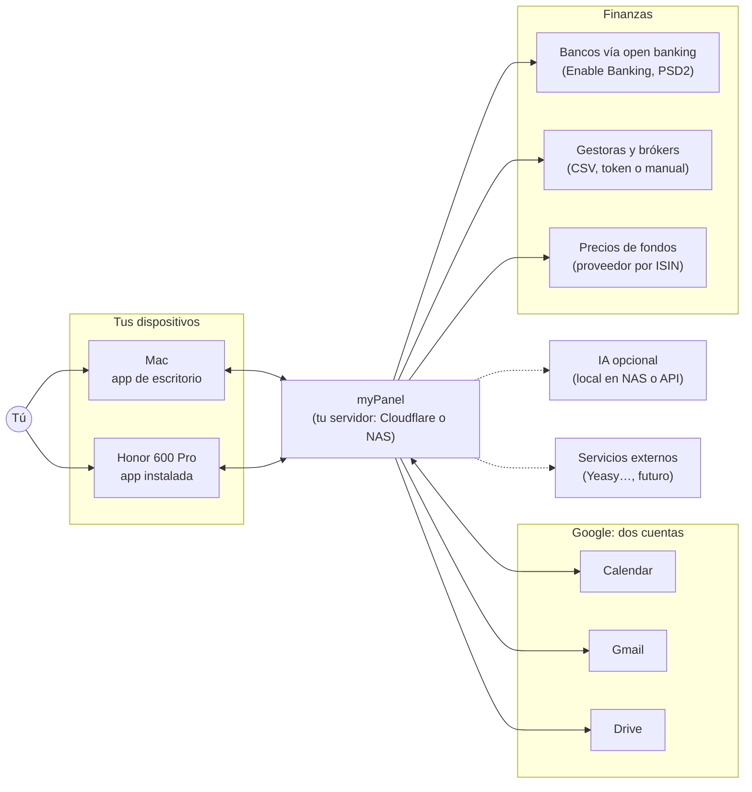
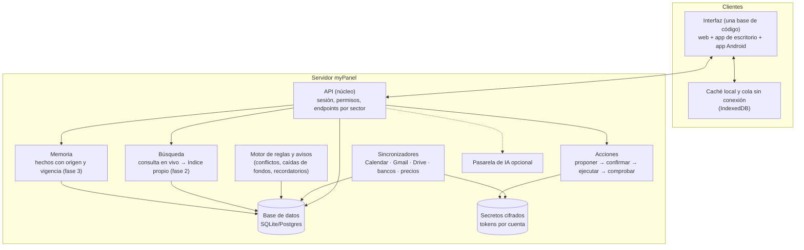
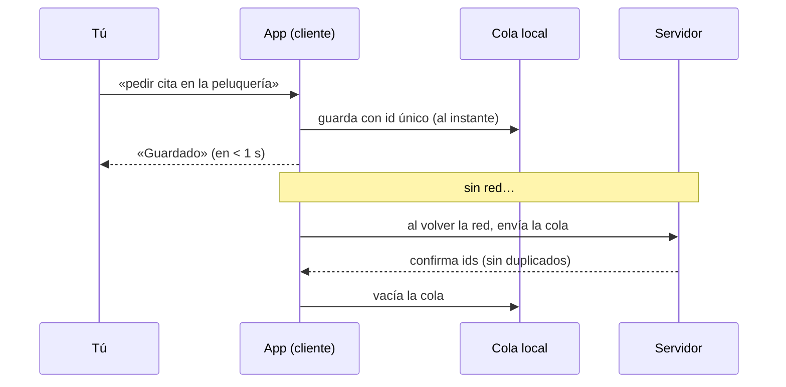
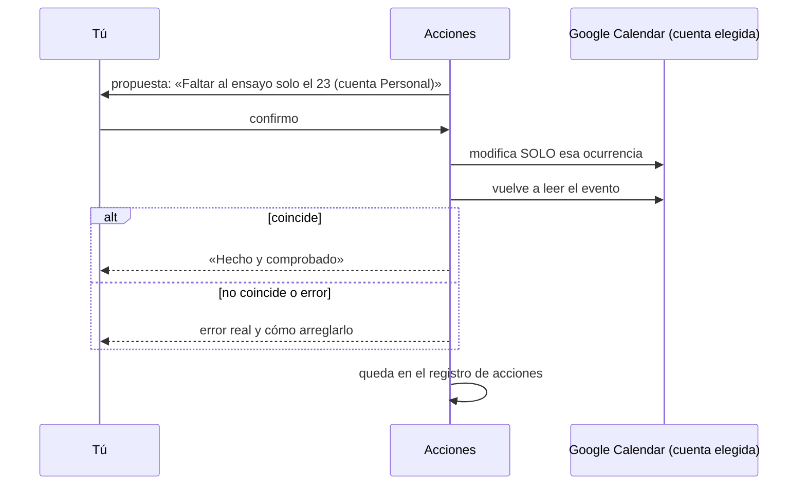
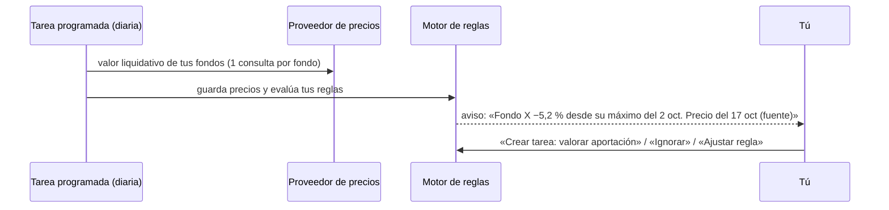
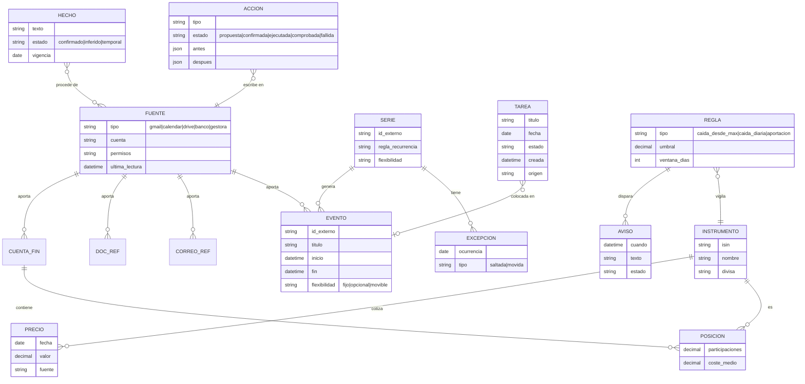

# 4. Arquitectura del sistema

Cómo funciona por dentro: piezas, flujos de datos, modelo de datos y decisiones abiertas. Es una propuesta; lo marcado como **[decisión abierta]** necesita tu respuesta o una prueba.

## 4.1 Contexto: con qué se conecta

Flechas dobles: lectura y escritura con confirmación. Flecha simple: solo lectura. Discontinua: opcional o futuro.

## 4.2 Piezas internas (contenedores)

Principio clave [P]: **API primero**. La interfaz habla con el servidor solo a través de la API. Así podemos cambiar o añadir clientes (por ejemplo, una app de Mac nativa en el futuro) sin rehacer el sistema.

## 4.3 Flujos críticos

### Captura sin conexión

### Escribir en el calendario (confirmar y comprobar)

### Aviso de caída de un fondo

## 4.4 Modelo de datos (primera versión)

## 4.5 Seguridad y privacidad
- Tokens de cada cuenta **cifrados** en el servidor; nunca en el navegador ni en el repositorio.
- Permisos mínimos por cuenta y por sector; se piden cuando se usa el sector, no todos al principio.
- Finanzas en **solo lectura** siempre.
- Registro de acciones auditable; exportar y borrar todos tus datos.
- Si hay NAS: datos sensibles (correo indexado, finanzas) en casa, con acceso privado (Tailscale o Cloudflare Tunnel con Access).

## 4.6 Decisiones abiertas (por orden de impacto)

### A. Plataforma de la app (decide el techo de calidad «nativa de Mac») — **[decisión abierta]**
| Opción | Mac | Android | Coste y riesgo |
|---|---|---|---|
| **1. Web instalable (PWA)** | Safari permite añadirla al Dock como app [I] | Instalable desde Chrome | Una base de código; techo de «sensación nativa» más bajo: sin barra de menús ni atajo global |
| **2. Web + carcasa Tauri en Mac** | Ventana nativa, barra de menús, atajo global de captura y notificaciones [I] | PWA (o Tauri móvil, menos maduro [H·s]) | La misma interfaz; compilar la app de Mac requiere un Mac o un servidor de integración continua con macOS |
| **3. Nativa: SwiftUI en Mac + Kotlin/Compose en Android** | Máxima calidad: Liquid Glass y convenciones reales | Nativa con widget | **Dos interfaces que mantener**; yo no puedo compilar ni probar SwiftUI desde este entorno Linux; más lento |
| **4. Compose Multiplatform** | Funciona, pero no se ve como una app de Mac [I] | Nativa | Una base Kotlin; aspecto no nativo en Mac |

Mi recomendación provisional [P]: **opción 2 con arquitectura API primero**. Da casi todo lo «nativo» que pides en el Mac (ventana propia, barra de menús, ⌘K global, notificaciones) sin duplicar la interfaz. Si más adelante el techo visual no basta, la API permite añadir un cliente SwiftUI para el Mac sin tocar el servidor.

### B. Dónde vive el servidor — **[decisión abierta]**
Cloudflare gratis para empezar, o **NAS** si quieres finanzas y correo indexados en casa. Con un sector de finanzas, el NAS gana peso [I].

### C. Fuentes de datos financieros — depende de tus entidades
Hace falta saber tus bancos, gestoras o brókers y fondos (ISIN) para elegir el conector de cada uno.

### D. IA y memoria — fase 3, con pruebas comparativas antes de elegir.
